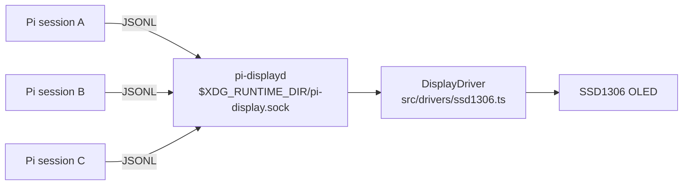

# pi-display

A [Pi](https://pi.dev) extension that drives I²C displays. The first implementation targets a 128×64 SSD1306 OLED. The architecture keeps hardware ownership out of the Pi process: a small local service owns the display, and the Pi extension is a thin client, so multiple Pi sessions can coexist without fighting over the bus.

## Architecture



- Display contract: `src/display.ts` (`DisplayDriver` + a row-major monochrome `DisplayFrame`)
- Hardware backend: `src/drivers/ssd1306.ts`
- Service: `src/service.ts` + `daemon/pi-displayd.ts` — owns the display, serves newline-delimited JSON requests (`src/protocol.ts`). The bound socket doubles as the single-instance lock.
- Client: `src/client.ts`; the extension (`extensions/index.ts`) uses it to show the logo at session start and stays idle otherwise.
- Assets: `assets/pi.pbm` loaded via `src/assets.ts` (portable bitmap, PBM P1).

Multiple Pi processes are supported: every session talks to the one service, and the display never receives concurrent writes.

## User journey

1. Install the extension and start Pi.
2. If the service is not running, Pi shows a warning suggesting `/display setup`.
3. `/display setup` checks the environment, writes a systemd user unit (`~/.config/systemd/user/pi-display.service`), enables and starts it, and confirms once the display shows the logo.
4. From then on it is invisible: sessions connect to the service automatically. `/display status` reports the current state at any time.

The service keeps the last frame on screen when Pi exits; it only releases the I²C handle on shutdown.

## Requirements

- Linux with `i2c-dev` loaded and access to `/dev/i2c-1` (on the tested host, membership in the `i2c` group).
- `i2c-bus` is a native Node.js module: building it needs `python3`, `make`, and `g++` (`build-essential` on Debian-based systems).
- systemd (user services) for `/display setup`; the daemon also runs standalone with `node daemon/pi-displayd.ts`.

## Development

```sh
npm install
npm test
pi --extension ./extensions/index.ts
```

Tests are hardware-free: the service and protocol are covered with a fake `DisplayDriver` and a real Unix socket in the temp directory.

## Direction

Keep the driver contract small and controller-agnostic. Next steps build on the service: richer notifications from Pi events, a priority/queue policy in the daemon, and additional display backends behind the same `DisplayDriver` interface.
