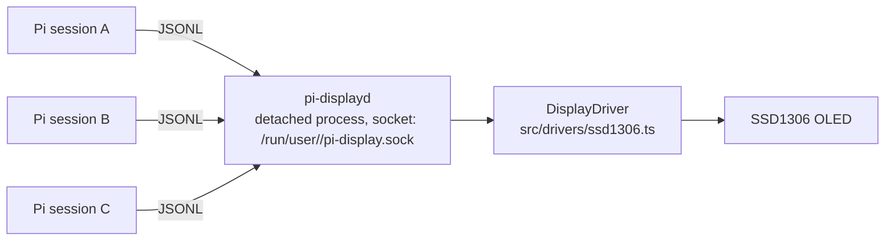

# pi-display

A [Pi](https://pi.dev) extension that drives I²C displays. The first implementation targets a 128×64 SSD1306 OLED. The architecture keeps hardware ownership out of the Pi process: a small local service owns the display, and the Pi extension is a thin client, so multiple Pi sessions can coexist without fighting over the bus.

## Architecture



- Display contract: `src/display.ts` (`DisplayDriver` + a row-major monochrome `DisplayFrame`)
- Hardware backend: `src/drivers/ssd1306.ts`
- Service: `src/service.ts` + `daemon/pi-displayd.ts` — owns the display, serves newline-delimited JSON requests (`src/protocol.ts`). The bound socket doubles as the single-instance lock.
- Client: `src/client.ts`; the extension (`extensions/index.ts`) starts the daemon on demand and shows the logo at session start.
- Assets: `assets/pi.pbm` loaded via `src/assets.ts` (portable bitmap, PBM P1).

The extension starts the daemon itself as a detached process the first time it is needed: no systemd, no root, no extra packages. Concurrent Pi sessions all talk to the one daemon, and the display never receives concurrent writes. The daemon keeps the last frame on screen and stays running after Pi exits; it starts again automatically with the next Pi session after a reboot or a crash.

## User journey

1. Install the extension, connect the display, start Pi.
2. At the first session the extension starts `pi-displayd` and the display shows the logo — nothing else to do.
3. `/display status` reports the daemon state; `/display start` starts it after a problem.

To run the daemon by hand: `node daemon/pi-displayd.ts`.

## Requirements

- Linux with `i2c-dev` loaded and access to `/dev/i2c-1` (on the tested host, membership in the `i2c` group).
- `i2c-bus` is a native Node.js module: building it needs `python3`, `make`, and `g++` (`build-essential` on Debian-based systems). No other system dependency: no systemd, no root.

## Development

```sh
npm install
npm test
pi --extension ./extensions/index.ts
```

Tests are hardware-free: the service and protocol are covered with a fake `DisplayDriver` and a real Unix socket in the temp directory.

## Direction

Keep the driver contract small and controller-agnostic. Next steps build on the service: richer notifications from Pi events, a priority/queue policy in the daemon, and additional display backends behind the same `DisplayDriver` interface.
