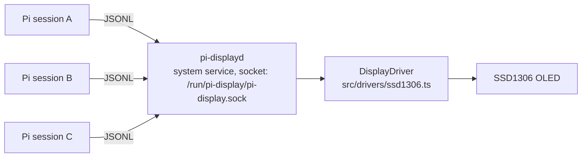

# pi-display

A [Pi](https://pi.dev) extension that drives I²C displays. The first implementation targets a 128×64 SSD1306 OLED. The architecture keeps hardware ownership out of the Pi process: a small local service owns the display, and the Pi extension is a thin client, so multiple Pi sessions can coexist without fighting over the bus.

## Architecture



- Display contract: `src/display.ts` (`DisplayDriver` + a row-major monochrome `DisplayFrame`)
- Hardware backend: `src/drivers/ssd1306.ts`
- Service: `src/service.ts` + `daemon/pi-displayd.ts` — owns the display, serves newline-delimited JSON requests (`src/protocol.ts`). The bound socket doubles as the single-instance lock.
- Compositor: `src/compositor.ts` — turns session data into screens: splash, one page per session (header / context bar / numbers + cost / inverted status footer), idle screen, rotation. Pixels: `src/pixels.ts`; text: `src/font.ts`.
- Client: `src/client.ts`; the extension (`index.ts`) connects at session start and shows the logo.
- Extension: `index.ts` — a sensor: on session events it pushes session data (name, context usage, cost, state) to the service over the socket.
- Assets: `assets/pi.pbm` (portable bitmap, PBM P1) and `assets/font5x7.bin` (classic 5×7 font) loaded via `src/assets.ts` / `src/font.ts`.
- Design: `docs/design.md` — screen layout, protocol v2, phases.

The daemon runs as a system systemd service: it starts at boot, restarts on failure, and survives Pi exits with the last frame on screen. Concurrent Pi sessions all talk to the one daemon, and the display never receives concurrent writes.

## User journey

1. Install the extension and start Pi.
2. `/display setup` prints the unit file and the two `sudo systemctl` commands; run them once in your terminal.
3. The display shows the logo, and every Pi session (even several at once) connects to the service automatically.
4. `/display status` reports the daemon state at any time.

To run the daemon by hand (debugging): `sudo node daemon/pi-displayd.ts`, or set `PI_DISPLAY_SOCKET` to a user-writable path and run it as your user.

## Requirements

- Linux with systemd as init (DietPi, Raspberry Pi OS, Ubuntu, ...), `i2c-dev` loaded, and access to `/dev/i2c-1` for the service user (on the tested host, membership in the `i2c` group).
- `i2c-bus` is a native Node.js module: building it needs `python3`, `make`, and `g++` (`build-essential` on Debian-based systems). No other system dependency and no extra packages.

## Development

```sh
npm install
npm test
pi --extension ./index.ts
```

Tests are hardware-free: the service and protocol are covered with a fake `DisplayDriver` and a real Unix socket in the temp directory.

## Credits

- `assets/font5x7.bin`: the classic 5×7 fixed-width font (ASCII 32–126), extracted from [Adafruit GFX](https://github.com/adafruit/Adafruit-GFX-Library)'s `glcdfont.c` (BSD-3-Clause); the font data itself was placed in the public domain by Mark Jones.

## Direction

Keep the driver contract small and controller-agnostic. Next steps build on the service: richer notifications from Pi events, a priority/queue policy in the daemon, and additional display backends behind the same `DisplayDriver` interface.
